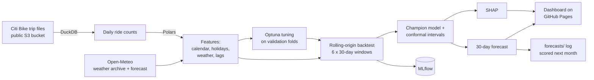

# NYC Citi Bike Demand Forecasting

[](https://github.com/dvskaff/citibike-demand-forecasting/actions/workflows/ci.yml)
[](https://github.com/dvskaff/citibike-demand-forecasting/actions/workflows/forecast.yml)

**Live dashboard: [dvskaff.github.io/citibike-demand-forecasting](https://dvskaff.github.io/citibike-demand-forecasting/)**

Forecasts daily ridership for New York's Citi Bike system 30 days ahead, using every public trip record since
2023 and daily weather. The pipeline benchmarks statistical baselines against gradient-boosted models with
rolling-origin backtesting, adds calibrated prediction intervals, explains the forecasts with SHAP, and retrains
itself every month with GitHub Actions, which republishes the dashboard and scores last month's forecast.

## Results

The table below is rewritten automatically after every monthly run.

<!-- RESULTS:START -->
_Results appear here after the first run of the **Monthly forecast** workflow._
<!-- RESULTS:END -->

**WAPE** (weighted absolute percentage error) = total absolute error ÷ total rides, so 5% means the forecast
was off by 5 rides for every 100. **Bias** is positive when the model over-forecasts.

## How it works



| Step | What happens | Tools |
|---|---|---|
| **Ingest** | Lists the public Citi Bike bucket, downloads only new monthly or yearly files, and condenses tens of millions of trips to daily counts by rider type and bike type. Each file's counts are cached, so monthly runs only fetch what is new. | DuckDB, requests |
| **Weather** | Observed daily weather for history, Open-Meteo's forecast for the next 16 days, and seasonal averages beyond that. | Open-Meteo API (free, no key) |
| **Features** | Day of week, US/NY holidays, Fourier seasonal terms, trend, temperature, rain, snow, wind, and demand lags of 30 days or more, so a 30-day forecast never uses a value from inside its own window. | Polars, holidays |
| **Models** | Seasonal naive, AutoETS and AutoARIMA baselines vs LightGBM (default and Optuna-tuned) and XGBoost. | statsforecast, LightGBM, XGBoost |
| **Evaluation** | Every model is refit at 6 forecast origins and scored on the next 30 days each time. Optuna tunes LightGBM on 3 *earlier* windows so the test windows stay unseen. | Optuna, pandas |
| **Uncertainty** | Split-conformal 80% and 95% intervals from the champion's relative backtest errors, with coverage checked on a held-out month. | NumPy |
| **Explainability** | SHAP values for the tuned tree model: overall importance plus the temperature effect. | SHAP |
| **Tracking** | Every run and model is logged to MLflow (SQLite backend, kept as a workflow artifact). Each forecast is saved to `forecasts/` and scored once the real numbers are published. | MLflow |
| **Automation** | Tests and lint on every push; a monthly job reruns the pipeline, commits the forecast log and results table, and redeploys the dashboard. | GitHub Actions, pytest, ruff, GitHub Pages |

## Repository layout

```
├── src/citibike/
│   ├── ingest.py       # bucket listing, zip handling, DuckDB aggregation, caching
│   ├── weather.py      # Open-Meteo archive + forecast + climatology fill
│   ├── features.py     # Polars feature engineering (leak-free lags)
│   ├── models.py       # statsforecast baselines, LightGBM, XGBoost behind one interface
│   ├── evaluation.py   # metrics, rolling-origin backtest, Optuna tuning, conformal intervals
│   ├── explain.py      # SHAP
│   ├── tracking.py     # MLflow logging, forecast log, README results table
│   ├── report.py       # Plotly dashboard (static HTML for GitHub Pages)
│   ├── sample.py       # synthetic data for tests and the offline demo
│   └── pipeline.py     # end-to-end entry point
├── tests/              # pytest: ingestion, leakage, backtest folds, intervals, weather, end-to-end
├── forecasts/          # every published forecast, committed by the monthly job
└── .github/workflows/  # ci.yml (tests on push) and forecast.yml (monthly retrain + deploy)
```

## Run it locally

```bash
python -m venv .venv && source .venv/bin/activate      # Windows: .venv\Scripts\activate
pip install -r requirements-dev.txt

export PYTHONPATH=src                                  # Windows: set PYTHONPATH=src
python -m citibike.pipeline --sample                   # offline demo on synthetic data (~1 min)
python -m citibike.pipeline                            # real data (downloads several GB, ~30+ min the first time)
pytest -q                                              # tests

open site/index.html                                   # the dashboard
mlflow ui --backend-store-uri sqlite:///mlflow.db      # browse tracked runs (needs the full `mlflow` package)
```

## Notes and limitations

- **Backtests use observed weather**, which flatters every model a little, since real forecasts rely on weather
  forecasts. The *Live accuracy tracking* section of the dashboard measures accuracy with the weather that was
  actually forecast at the time.
- Days beyond Open-Meteo's 16-day forecast use seasonal-average weather; the dashboard shades them.
- Citi Bike publishes each month's trips with a short delay, so the forecast starts the day after the latest
  published data rather than today.

## Data

- Trip data: [Citi Bike System Data](https://citibikenyc.com/system-data), used under the
  [NYCBS Data Use Policy](https://citibikenyc.com/data-sharing-policy).
- Weather: [Open-Meteo](https://open-meteo.com/) (CC BY 4.0).

---
